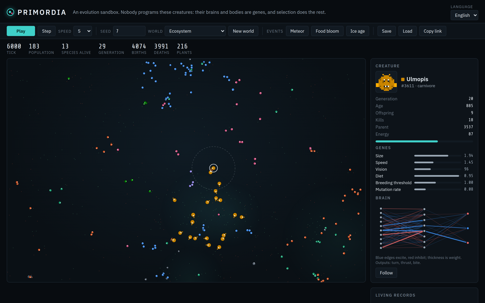
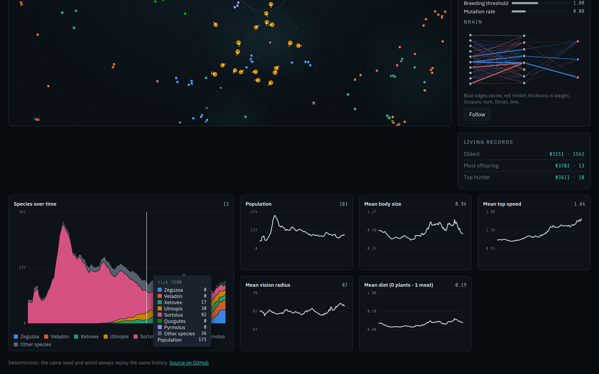

<h1 align="center">Primordia</h1>

<p align="center">
  <b>An evolution sandbox in the browser.</b><br>
  Nobody programs these creatures. Their bodies and their brains are genes; they eat, hunt, breed with
  mutation and die, and natural selection does the rest. Watch species branch, predators and prey co-evolve,
  and traits drift on live charts. Deterministic seeds, save files, no server.
</p>

<p align="center">
  
</p>

**Live:** https://ardakalper.github.io/primordia/

## What evolves

- **Brains (neuroevolution).** Each creature carries a small neural network (10 inputs → 8 hidden → 3 outputs)
  whose weights are genes. It sees the nearest food and the nearest creature in its own body frame, how big that
  creature is relative to itself, whether it is kin, and its own energy; it outputs turn, thrust and bite.
  Steering, chasing, fleeing and when to bite are not coded: they are found by selection.
- **Bodies with real trade-offs.** Size, top speed, vision radius, diet (plants ↔ meat), breeding threshold and
  even the mutation rate are genes, and every one has an energy price: metabolism grows with size², movement with
  size × speed², vision with radius. No creature can afford to be big, fast, far-sighted and omnivorous at once,
  so niches appear on their own.
- **A food web.** Plants grow in fertile patches that slowly drift. Bodies that starve or die of old age become
  meat that rots away. Carnivores digest meat, herbivores plants, omnivores a bit of both, and a creature can bite
  anything at least 15% smaller than itself.
- **Speciation.** A child whose genome drifts far enough from its species' founder founds a new species with a
  generated name. Species rise, branch and go extinct on the stacked chart.

Ancestors start with a crude food-seeking reflex (and a small hunter lineage with a chase-and-bite reflex) so
the first generations don't starve before selection has anything to work with; everything after that is drift
and selection.

<p align="center">
  
</p>

## The lab

- **Inspector:** click any creature for its species, generation, age, energy, offspring, kills, parent, gene bars,
  a pixel portrait drawn from its genome, and a live diagram of its brain (blue edges excite, red inhibit).
  Follow it with the camera.
- **Living records:** the oldest creature, the most prolific parent and the top hunter, one click away.
- **Charts:** species over time (stacked, colour-stable per species, top seven plus "Other"), population, and
  mean body size, speed, vision and diet, all with hover read-outs.
- **Worlds and events:** presets (ecosystem, calm pond without hunters, hunter pressure, scarcity, lush, high
  mutation), plus meteor, food bloom and ice age at the press of a button.
- **Deterministic:** a seeded PRNG drives everything, so the same seed and world always replay the same history.
  Share a run with a link (`?seed=…&preset=…`), or save the whole world to a file and load it later; it resumes
  on exactly the same timeline.
- Camera with wheel zoom, drag to pan on a wrap-around world, double-click to reset. Space pauses.
  English and Turkish. Works offline.

## Run it locally

```sh
git clone https://github.com/ardakalper/primordia
cd primordia
npm start            # serves app/ on http://localhost:4178
```

## Tests

```sh
npm install
npm run test:unit    # PRNG, genome bounds, the inherited reflexes, the torus spatial grid against brute force,
                     # determinism, a 6000-tick world that must live, evolve and speciate, energy economy,
                     # hunting, events, save → load continuing the exact timeline, i18n parity
npm run test:e2e     # Playwright: play / pause / step, seed replay, inspector, events, chart tooltip,
                     # save and load, extinction banner, Turkish
```

Set `PW_CHROMIUM_PATH=/path/to/chrome` to reuse an installed Chromium. CI runs both suites on every push and
deploys `app/` to GitHub Pages when `main` is green.

## How it is built

```
app/js/sim.js     the pure, deterministic simulation: PRNG, genome and mutation, MLP brains, torus spatial hash,
                  metabolism, eating and hunting, reproduction, speciation, sampling, events, save / load
app/js/render.js  world view with a wrap-around camera, sticky species colour slots, portraits, brain diagram
app/js/charts.js  small canvas charts: stacked species area, single-series trait lines, crosshair hover
app/js/main.js    run loop with a frame-time budget, inspector, records, controls, files
app/js/i18n.js    English and Turkish
```

Neighbour queries go through a spatial hash whose cells divide the world exactly, so wrapped queries never miss
a seam; a unit test checks it against brute force. The run loop advances as many ticks as the chosen speed
allows within a 12 ms budget, then draws once. Species colours come from a validated colour-blind-safe dark
palette and stay with a species for its whole life.

## License

MIT.

---

### Türkçe özet

**Primordia**, tarayıcıda çalışan bir evrim kum havuzu. Canlıları kimse programlamıyor: bedenleri ve beyinleri
gen. Her canlının ağırlıkları gen olan küçük bir sinir ağı var; yemeği ve diğer canlıları görüp dönmeye,
hızlanmaya ve ısırmaya kendisi karar veriyor. Boy, hız, görüş, beslenme, üreme eşiği ve mutasyon oranının her
birinin enerji bedeli olduğu için nişler kendiliğinden oluşuyor. Genomu yeterince uzaklaşan yavrular yeni tür
kuruyor. Bir canlıya tıklayınca genlerini, beyin diyagramını ve genomundan çizilen piksel portresini görürsün.
Türler ve özellik ortalamaları canlı grafiklerde izlenir. Göktaşı, yemek patlaması ve buzul çağı olayları var.
Seed'li ve deterministik: aynı seed aynı tarihi yeniden oynatır; dünyayı dosyaya kaydedip aynı zaman çizgisinden
devam ettirebilirsin.
